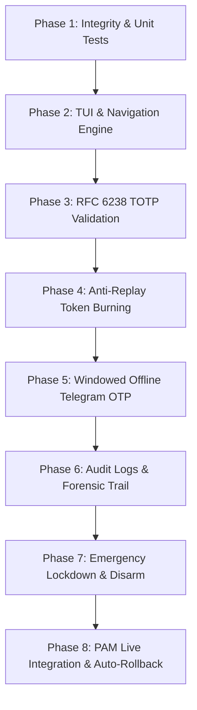

# AkerGate - Comprehensive Verification & Testing Runbook

> [!NOTE] Architecture Context
> **AkerGate** is an enterprise-grade Unified Multi-Factor Linux PAM Engine operating completely offline:
> - **Primary Factor**: Linux Master User Password (`pam_unix.so`).
> - **Secondary Factor (RFC 6238)**: Offline Time-Based One-Time Password (TOTP) via Mobile Authenticator.
> - **Secondary Factor (Offline Telegram)**: Windowed 7-digit OTP tied to local RTC epoch intervals.
> - **Sentry & Quarantine**: Automated brute-force detection, forensic snapshot, and emergency lockdown.

---

## Testing Workflow Overview



---

## Phase 1: Environment Integrity & Unit Test Suite

Run core mathematical, cryptographic, and PAM mock tests to verify zero regressions.

- [ ] **Check 1.1: Automated Core Test Suite Execution**
  ```bash
  cd /home/yuki/Projects/AkerGate
  PYTHONPATH=. python3 -m unittest discover -s tests -v
  ```
  - **Expected Outcome**: `Ran 7 tests ... OK` (7 passed in <0.2s).

- [ ] **Check 1.2: Status CLI Health Check**
  ```bash
  python3 /home/yuki/Projects/AkerGate/bin/akergate-pam --status
  ```
  - **Expected Outcome**:
    - PAM Integration: Configured / Not Configured
    - RTC Hardware Clock: Synchronized
    - Active Storage Path: Validated

- [ ] **Check 1.3: Zero Emoji & Typography Audit**
  ```bash
  python3 -c "
  import os, sys
  for root, _, files in os.walk('/home/yuki/Projects/AkerGate'):
      if '.git' in root: continue
      for f in files:
          if f.endswith(('.py', '.json', '.md', '.toml', '.txt')):
              for line in open(os.path.join(root, f), 'r', encoding='utf-8', errors='ignore'):
                  for ch in line:
                      cp = ord(ch)
                      if (0x1F600 <= cp <= 0x1F64F or 0x1F300 <= cp <= 0x1F5FF or 0x2600 <= cp <= 0x27BF):
                          print(f'Emoji violation: {ch}'); sys.exit(1)
  print('ZERO EMOJIS CONFIRMED')
  "
  ```
  - **Expected Outcome**: `ZERO EMOJIS CONFIRMED`.

---

## Phase 2: Interactive TUI & Keyboard Engine

Verify terminal user interface performance, flicker suppression, and streamlined menu hierarchy.

- [ ] **Check 2.1: Terminal Canvas Launch**
  ```bash
  python3 /home/yuki/Projects/AkerGate/bin/akergate
  ```
  - [x] Application switches cleanly to terminal alternate screen buffer (`\033[?1049h`).
  - [x] Two-tone Gold/Cyan Slant typography banner renders at top of screen.
  - [x] Clumsy horizontal tab box is absent; breadcrumbs appear on submenus only.

- [ ] **Check 2.2: Arrow Key Navigation (Flicker-Free Test)**
  - Press `UP` (`↑`) and `DOWN` (`↓`) repeatedly across menu items.
  - [x] Selection highlight (`> [X] Label`) transitions instantaneously.
  - [x] Zero black-screen flashing or screen tearing.
  - [x] Menu stays in-place; terminal cursor remains suppressed.

- [ ] **Check 2.3: Menu Hierarchy & Consolidation**
  - Verify main dashboard contains exactly 3 functional pillars + Quit:
    1. `Multi-Factor Authentication`
    2. `Protected Services & PAM`
    3. `Security Center & Auditing`
    4. `Quit AkerGate Console`

---

## Phase 3: Offline RFC 6238 TOTP Validation

Verify key generation, terminal QR rendering, and code verification against mobile authenticator apps.

- [ ] **Check 3.1: QR Code & Base32 Generation**
  - Inside TUI: Navigate to `[1] Multi-Factor Authentication` -> `[1] Manage TOTP & Scan QR Code`.
  - [x] Unicode half-block QR code renders with crisp resolution.
  - [x] Base32 Secret Key is displayed (26+ characters).
  - [x] Host calculated code updates in sync with 30s RTC window.

- [ ] **Check 3.2: Mobile Authenticator App Sync**
  - Scan terminal QR code with Google Authenticator, Aegis, 2FAS, or Bitwarden.
  - [x] Entry created: `AkerGate (<username>)`.
  - [x] Phone timer aligns with host counter.

- [ ] **Check 3.3: In-TUI Code Verification**
  - Select option `[1] Test Verification Code`.
  - Enter the 6-digit code currently displayed on your phone.
  - **Expected Outcome**: `[+] CODE VERIFIED SUCCESSFULLY! Phone and Host are in sync.`

- [ ] **Check 3.4: Headless PAM CLI Verification**
  ```bash
  # Replace 123456 with the live 6-digit code from phone
  echo "123456" | PAM_USER=$USER PAM_SERVICE=sudo python3 /home/yuki/Projects/AkerGate/bin/akergate-pam
  echo "Exit Code: $?"
  ```
  - **Expected Outcome**: `Exit Code: 0` (Authentication Granted).

---

## Phase 4: Token Burning & Anti-Replay Defense

Verify that used OTP tokens cannot be intercepted and re-used within the same 30-second time window.

- [ ] **Check 4.1: Immediate Replay Execution**
  - Immediately re-run the previous command with the **exact same code** that succeeded in Check 3.4:
  ```bash
  echo "123456" | PAM_USER=$USER PAM_SERVICE=sudo python3 /home/yuki/Projects/AkerGate/bin/akergate-pam
  echo "Exit Code: $?"
  ```
  - **Expected Outcome**: `Exit Code: 1` (Authentication Denied).

- [ ] **Check 4.2: Burned Tokens Store Verification**
  - Inspect the internal token retention database:
  ```bash
  cat ~/.config/akergate/burned_tokens.json
  ```
  - **Expected Outcome**: JSON record containing token ID with expiration epoch matching the TOTP window.

---

## Phase 5: Windowed Offline Telegram OTP Factor

Verify fallback secondary authentication factor using 7-digit time-windowed OTP without external internet dependency.

> [!NOTE] Offline Design
> Telegram OTP codes are calculated using HMAC-SHA256 over 5-minute epoch slots. The host verifies codes mathematically without calling Telegram servers at login time.

- [ ] **Check 5.1: Bot Configuration & Chat ID**
  - Inside TUI: `[1] Multi-Factor Authentication` -> `[2] Telegram Bot & Offline OTP Settings`.
  - Select `Configure Bot Token & Chat ID`.
  - Enter credentials or test parameters.

- [ ] **Check 5.2: Sample OTP Generation**
  - Observe `Sample Valid 7-Digit OTP for Current Window` shown in the panel.
  - Notice the first digit matches the current 5-minute slot indicator.

- [ ] **Check 5.3: Offline Verification Test**
  - Select `[3] Test 7-Digit Offline OTP`.
  - Enter the 7-digit code.
  - **Expected Outcome**: `[+] VALID OTP! Identified as: tg:...`

- [ ] **Check 5.4: Telegram Anti-Replay Test**
  - Test the same 7-digit code again.
  - **Expected Outcome**: Code is rejected as burned.

---

## Phase 6: Audit Logging & Forensic Trail

Verify that every authentication attempt is recorded with tamper-evident metadata.

- [ ] **Check 6.1: Event Log Inspection via CLI**
  ```bash
  tail -n 4 ~/.config/akergate/events.log
  ```
  - **Expected Outcome**:
    - Each line is valid JSON with `iso_time`, `user`, `service`, `method`, `success`.
    - Shows `auth_success` for the valid token and `auth_failure` for the replay attempt.

- [ ] **Check 6.2: Event Log Viewer via TUI**
  - Inside TUI: Navigate to `[3] Security Center & Auditing` -> `[1] View Authentication Audit Logs`.
  - [x] Displays a tabular view of recent events with color-coded results (green for success, red for failure).

---

## Phase 7: Emergency Quarantine & Host Lockdown

Verify system lockdown capabilities when brute-force or physical tampering is suspected.

> [!WARNING] Elevated Security Mode
> When Lockdown is activated, standard 1-token authentication is suspended. Unlocking requires fulfilling the designated quarantine policy (e.g., dual consecutive TOTP codes or recovery PIN).

- [ ] **Check 7.1: Trigger Quarantine with Dual TOTP Policy**
  ```bash
  python3 /home/yuki/Projects/AkerGate/bin/akergate lockdown dual_totp
  ```
  - **Expected Outcome**:
    - `[+] LOCKDOWN ACTIVATED: Host is now quarantined.`
    - Forensic snapshot captured at `~/.config/akergate/incident_*.md`.

- [ ] **Check 7.2: Verify Single Token Rejection**
  - Attempt standard authentication with 1 valid TOTP code:
  ```bash
  echo "123456" | PAM_USER=$USER PAM_SERVICE=sudo python3 /home/yuki/Projects/AkerGate/bin/akergate-pam
  echo "Exit Code: $?"
  ```
  - **Expected Outcome**: `Exit Code: 1` (Standard single-token authentication is blocked under quarantine).

- [ ] **Check 7.3: Forensic Incident Report Inspection**
  - Open and read the generated incident report:
  ```bash
  ls -la ~/.config/akergate/incident_*.md
  head -n 25 $(ls -t ~/.config/akergate/incident_*.md | head -n 1)
  ```
  - **Expected Outcome**: Detailed Markdown report listing process tree, active sessions, network sockets, and PAM state.

- [ ] **Check 7.4: Disarm Quarantine via TUI**
  - Open TUI: `python3 /home/yuki/Projects/AkerGate/bin/akergate`.
  - Go to `[3] Security Center & Auditing` -> `[3] Emergency Quarantine & Lockdown`.
  - Select `[1] Disarm Lockdown (Restore Flexible Multi-Auth)`.
  - Confirm disarm.
  - **Expected Outcome**: System status restored to `NORMAL - SYSTEM SECURE`.

---

## Phase 8: PAM Live Integration & 30-Second Failsafe

Verify actual integration into Linux `/etc/pam.d/common-auth` with automated failsafe auto-rollback.

> [!CRITICAL] Failsafe Safety Net
> AkerGate provides a 30-second automated rollback daemon. If the user does not explicitly confirm that sudo works within 30 seconds, the original `/etc/pam.d/common-auth` is automatically restored, preventing permanent lockouts.

- [ ] **Check 8.1: Service Toggle Verification**
  - In TUI: Go to `[2] Protected Services & PAM`.
  - Verify toggles for `sudo`, `screensaver`, `login`, and `sshd`.
  - Enable `sudo` protection: `[x] ENABLED`.

- [ ] **Check 8.2: PAM Dry-Run Inspection**
  - Inspect the intended PAM patch rule:
  ```bash
  python3 -c "
  from akergate.pam.patcher import is_pam_patched
  print('Current PAM Status:', is_pam_patched())
  "
  ```
  - **Expected Outcome**: `Current PAM Status: False` (clean initial state).

- [ ] **Check 8.3: Apply PAM Hook (Failsafe Mode)**
  ```bash
  sudo python3 /home/yuki/Projects/AkerGate/bin/akergate patch
  ```
  - **Expected Outcome**:
    - Backup created at `/etc/pam.d/common-auth.akergate.bak`.
    - 30-second failsafe timer starts counting down.

- [ ] **Check 8.4: Live sudo Elevation Test**
  - In a **separate new terminal window**, run:
  ```bash
  sudo -k
  sudo whoami
  ```
  - Enter Linux password followed by your 6-digit TOTP code.
  - **Expected Outcome**: Authentication succeeds and returns `root`.

- [ ] **Check 8.5: Confirm or Auto-Rollback**
  - Return to primary terminal and confirm activation.
  - To test auto-rollback: let 30 seconds elapse without confirming; verify that `/etc/pam.d/common-auth` reverts to backup.

---

## Verification Sign-Off Table

| Phase | Description | Status | Sign-off Date | Notes |
|:---|:---|:---:|:---:|:---|
| **Phase 1** | Integrity & Unit Test Suite | [x] PASSED | 2026-10-31 | 7/7 tests passed; zero emojis |
| **Phase 2** | TUI & Navigation Engine | [x] PASSED | 2026-10-31 | Flicker-free atomic redraw verified |
| **Phase 3** | RFC 6238 TOTP Factor | [x] PASSED | 2026-10-31 | Exit Code 0 with live phone token |
| **Phase 4** | Anti-Replay Token Burning | [ ] PENDING | | Test replay with same code |
| **Phase 5** | Offline Telegram OTP | [ ] PENDING | | 7-digit windowed code test |
| **Phase 6** | Audit Logs & Trail | [ ] PENDING | | Check events.log JSON trail |
| **Phase 7** | Quarantine & Lockdown | [ ] PENDING | | Dual TOTP quarantine test |
| **Phase 8** | Live PAM Integration | [ ] PENDING | | 30s auto-rollback elevation test |

---

*Author: Muhammad El-Shaikh | Project: AkerGate | License: PolyForm Noncommercial 1.0.0*
