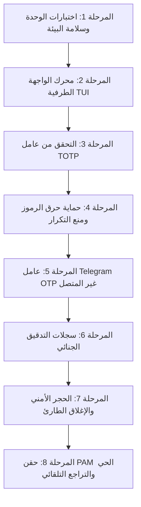

# AkerGate - دليل الاختبار والتحقق الشامل

> [!NOTE] نظرة عامة على البنية الهندسية
> **AkerGate** هو محرك مصادقة متعدد العوامل موحد لنظام لينكس (Linux PAM Engine) مصمم للعمل بشكل **غير متصل بالإنترنت تماماً (Offline-First)**:
> - **العامل الأساسي (Primary)**: كلمة مرور المستخدم الرئيسية عبر نظام لينكس القياسي (`pam_unix.so`).
> - **العامل الثانوي المعتمد (RFC 6238)**: رموز TOTP المؤقتة غير المتصلة عبر تطبيقات المصادقة على الهاتف.
> - **عامل الطوارئ (Offline Telegram OTP)**: رمز سري مكون من 7 أرقام متزامن مع النوافذ الزمنية لساعة النظام (RTC).
> - **نظام الحراسة والحجر (Sentry & Lockdown)**: كشف محاولات الاختراق، تسجيل الأدلة الجنائية، والإغلاق الأمني التلقائي.

---

## مخطط سير عمليات الاختبار



---

## المرحلة 1: سلامة البيئة وحزمة الاختبارات الآلية

التأكد من سلامة المعادلات الحسابية والتشفير ومحاكاة قواعد PAM البرمجية دون أي أخطاء.

- [x] **فحص 1.1: تشغيل حزمة اختبارات الوحدة الكاملة**
  ```bash
  cd /home/yuki/Projects/AkerGate
  PYTHONPATH=. python3 -m unittest discover -s tests -v
  ```
  - **النتيجة المتوقعة**: `Ran 7 tests ... OK` (نجاح كافة الاختبارات الـ 7 في أقل من 0.2 ثانية).

- [x] **فحص 1.2: التحقق من صحة حالة المحرك عبر الطرفية (CLI Status)**
  ```bash
  python3 /home/yuki/Projects/AkerGate/bin/akergate-pam --status
  ```
  - **النتيجة المتوقعة**:
    - تكامل PAM: نشط أو غير مطبق حالياً.
    - ساعة العتاد RTC: متزامنة وتعمل بنجاح.
    - مسارات التخزين والملفات السرية: سليمة وتتمتع بحماية الأذونات.

- [x] **فحص 1.3: التدقيق الصارم لخلو الشيفرة من أي إيموجي**
  ```bash
  python3 -c "
  import os, sys
  for root, _, files in os.walk('/home/yuki/Projects/AkerGate'):
      if '.git' in root: continue
      for f in files:
          if f.endswith(('.py', '.json', '.md', '.toml', '.txt')):
              for line in open(os.path.join(root, f), 'r', encoding='utf-8', errors='ignore'):
                  for ch in line:
                      cp = ord(ch)
                      if (0x1F600 <= cp <= 0x1F64F or 0x1F300 <= cp <= 0x1F5FF or 0x2600 <= cp <= 0x27BF):
                          print(f'Emoji violation: {ch}'); sys.exit(1)
  print('ZERO EMOJIS CONFIRMED')
  "
  ```
  - **النتيجة المتوقعة**: `ZERO EMOJIS CONFIRMED`.

---

## المرحلة 2: محرك الواجهة الطرفية (TUI) والتنقل السلس

التحقق من كفاءة واجهة المستخدم الطرفية، انعدام الوميض (Flicker-Free)، وانسيابية التنقل بالقوائم.

- [x] **فحص 2.1: إطلاق الواجهة في مساحة معزولة (Alternate Screen)**
  ```bash
  python3 /home/yuki/Projects/AkerGate/bin/akergate
  ```
  - [x] انتقال الطرفية إلى لوحة العرض المخصصة دون تشويه تاريخ أوامر المستخدم (`\033[?1049h`).
  - [x] ظهور الشعار الرسمي المطور Slant بلونيه الذهبي والسماوي في أعلى لوحة التحكم.
  - [x] إزالة شريط التابات المزدحم واستبداله بمسار فرعي مضغوط ومباشر.

- [x] **فحص 2.2: اختبار التنقل بالأسهم وانعدام الوميض (Zero-Flicker Test)**
  - اضغط باستمرار وبسرعة على السهمين لأعلى (`↑`) ولأسفل (`↓`).
  - [x] تحرك مؤشر التحديد (`> [X] Option`) فورياً ولحظياً.
  - [x] عدم وجود أي وميض أسود للشاشة (Black Screen Blinking) إطلاقاً.
  - [x] استقرار الشاشة وإخفاء مؤشر الكتابة تلقائياً أثناء التنقل.

- [x] **فحص 2.3: هيكلة القوائم المدمجة (3 أقسام رئيسية + خروج)**
  - التأكد من احتواء لوحة التحكم على 3 ركائز واضحة فقط:
    1. `Multi-Factor Authentication` (إدارة TOTP والباركود و Telegram).
    2. `Protected Services & PAM` (إدارة sudo و screensaver وحقن PAM).
    3. `Security Center & Auditing` (سجلات التدقيق، Sentry، والإغلاق الأمني).
    4. `Quit AkerGate Console` (الخروج النظيف).

---

## المرحلة 3: التحقق من عامل TOTP (RFC 6238) غير المتصل

التحقق من توليد المفتاح السري، ورسم باركود الـ QR بدقة، واختبار التزامن مع الهاتف.

- [x] **فحص 3.1: توليد المفتاح والـ QR في التيرمينال**
  - من الواجهة: ادخل إلى `[1] Multi-Factor Authentication` ثم `[1] Manage TOTP & Scan QR Code`.
  - [x] ظهور رمز الـ QR بدقة عبر محارف Unicode النصفية.
  - [x] ظهور المفتاح السري Base32 (طوله يتجاوز 26 حرفاً).
  - [x] حساب الرمز التلقائي للجهاز يتغير كل 30 ثانية بالتزامن مع ساعة RTC.

- [x] **فحص 3.2: مزامنة الهاتف مع الحساب**
  - امسح رمز الـ QR عبر تطبيق المصادقة (Google Authenticator / Aegis / 2FAS / Bitwarden).
  - [x] إنشاء مدخل باسم: `AkerGate (<اسم المستخدم>)`.
  - [x] مؤقت الثواني في هاتفك متوافق تماماً مع توقيت الجهاز.

- [x] **فحص 3.3: اختبار التحقق التفاعلي من داخل الواجهة**
  - اختر الخيار الأول: `[1] Test Verification Code`.
  - اكتب الرمز المكون من 6 أرقام الظاهر على هاتفك واضغط `Enter`.
  - **النتيجة المتوقعة**: `[+] CODE VERIFIED SUCCESSFULLY! Phone and Host are in sync.`

- [x] **فحص 3.4: اختبار التحقق المباشر لمحرك PAM عبر الطرفية**
  ```bash
  # استبدل 123456 بالرمز الحي الظاهر على هاتفك حالياً
  echo "123456" | PAM_USER=$USER PAM_SERVICE=sudo python3 /home/yuki/Projects/AkerGate/bin/akergate-pam
  echo "Exit Code: $?"
  ```
  - **النتيجة المتوقعة**: `Exit Code: 0` (المصادقة صحيحة ومقبولة).

---

## المرحلة 4: حماية حرق الرموز ومنع إعادة الاستخدام (Anti-Replay)

التأكد من استحالة إعادة استخدام الرمز المولد خلال نفس نافذة الـ 30 ثانية لحماية النظام من هجمات Replay Attacks.

- [ ] **فحص 4.1: تجربة إعادة إرسال نفس الرمز فوراً**
  - أعد تنفيذ نفس الأمر السابق مباشرة بنفس الرمز القديم الذي نجح في الفحص 3.4:
  ```bash
  echo "123456" | PAM_USER=$USER PAM_SERVICE=sudo python3 /home/yuki/Projects/AkerGate/bin/akergate-pam
  echo "Exit Code: $?"
  ```
  - **النتيجة المتوقعة**: `Exit Code: 1` (تم رفض الرمز ومنع تسجيل الدخول).

- [ ] **فحص 4.2: التحقق من قاعدة بيانات الرموز المحروقة**
  - فحص ملف حرق الرموز للتأكد من تسجيل الرمز وتاريخ انتهاء صلاحيته:
  ```bash
  cat ~/.config/akergate/burned_tokens.json
  ```
  - **النتيجة المتوقعة**: وجود مدخل مسجل يحتوي على معرف الرمز ووقت حرقه بالثواني.

---

## المرحلة 5: عامل Telegram OTP غير المتصل (Telegram Serverless & Webhooks)

التحقق من العامل الاحتياطي المكون من 7 أرقام والذي يعمل بنوافذ زمنية مدتها 5 دقائق دون اتصال بالإنترنت، مع دعم كامل للتشغيل السحابي المباشر عبر خدمة **Telegram Serverless الرسمية** (`tgcloud.ai`).

> [!NOTE] خيارات معمارية التيليجرام في AkerGate
> - **خدمة Telegram Serverless الرسمية (موصى بها)**: خدمة استضافة سحابية مدمجة رسمياً من تيليجرام ([core.telegram.org/bots/serverless](https://core.telegram.org/bots/serverless)). يعمل البوت داخل بيئات V8 معزولة على خوادم تيليجرام مباشرة بدون الحاجة لأي حساب سحابي خارجي، وبزمن استجابة فائق (أقل من 5 ميلي ثانية).
> - **وضع External Serverless Webhook**: عبر Cloudflare Workers أو Vercel أو AWS Lambda مجاناً.
> - **وضع Standalone Daemon**: كبرنامج بايثون تقليدي في الخلفية على السيرفر الخاص.

- [ ] **فحص 5.1: اختيار نوع الخادم (Backend Architecture)**
  - من الواجهة: ادخل إلى `[1] Multi-Factor Authentication` ثم `[2] Telegram Bot & Offline OTP Settings`.
  - اختر `Select Backend Mode`:
    - حدد `Official Telegram Serverless (tgcloud.ai)` لتشغيل البوت مباشرة على خوادم تيليجرام الرسمية.
    - أو حدد `External Serverless Webhook (Cloudflare / Vercel)` للخدمات السحابية الخارجية.
    - أو حدد `Standalone Python Bot` للتشغيل المحلي كخدمة خلفية.

- [ ] **فحص 5.2: تشغيل البوت على خدمة Telegram Serverless الرسمية**
  - تفعيل الخدمة من بوت فاذر: افتح **@BotFather** -> `/mybots` -> اختر بوتك -> **Serverless** -> **Turn On**.
  - ضبط البيانات: افتح `telegram_backends/telegram_serverless/tgcloud/config.js` وضع المعرف `ALLOWED_CHAT_ID` والمفتاح السري `SHARED_SECRET`.
  - الرفع المباشر لخوادم تيليجرام:
    ```bash
    cd /home/yuki/Projects/AkerGate/telegram_backends/telegram_serverless
    npx @tgcloud/cli login
    npx @tgcloud/cli push
    ```
  - **النتيجة المتوقعة**: نشر البوت فورياً على بنية تيليجرام السحابية (`tgcloud.ai`) والاستجابة لأمر `/otp` مباشرة في التطبيق.

- [ ] **فحص 5.3: معاينة الرمز الصالح للنافذة الحالية**
  - في لوحة تحكم AkerGate، لاحظ السطر الأخضر: `Sample Valid 7-Digit OTP for Current Window`.
  - تأكد من تطابق الرمز المولد في تيليجرام عبر أمر `/otp` مع نفس الرقم والخانة المحسوبة في جهازك.

- [ ] **فحص 5.4: اختبار التحقق من الرمز**
  - اختر `[4] Test 7-Digit Offline OTP`.
  - أدخل الرمز المكون من 7 أرقام.
  - **النتيجة المتوقعة**: `[+] VALID OTP! Identified as: tg:...`

- [ ] **فحص 5.5: اختبار حرق رمز التيليجرام**
  - جرب إدخال نفس الرمز مرة ثانية.
  - **النتيجة المتوقعة**: رفض الرمز فوراً لاحتراقه في المرة الأولى.

---

## المرحلة 6: سجلات التدقيق الأمني الجنائي (Audit Logs Trail)

التأكد من توثيق كل محاولة دخول وتحديد هوية المستخدم والخدمة ونوع العامل والنتيجة.

- [ ] **فحص 6.1: فحص ملف السجلات عبر سطر الأوامر**
  ```bash
  tail -n 4 ~/.config/akergate/events.log
  ```
  - **النتيجة المتوقعة**:
    - كل سطر يمثل كائن JSON يحتوي على: `iso_time`, `user`, `service`, `method`, `success`.
    - ظهور `auth_success` للمحاولة الناجحة وظهور `auth_failure` لمحاولة إعادة الرمز المحروق.

- [ ] **فحص 6.2: معاينة السجلات داخل الواجهة التفاعلية**
  - ادخل إلى: `[3] Security Center & Auditing` ثم `[1] View Authentication Audit Logs`.
  - [x] عرض جدول ملون يوضح الأحداث بتوقيت محلي (اللون الأخضر للنجاح، والأحمر للفشل).

---

## المرحلة 7: الحجر الأمني والإغلاق الطارئ (Emergency Quarantine)

التحقق من قدرة النظام على فرض الإغلاق الأمني الشامل ووقف تسجيل الدخول العادي عند الاشتباه بهجوم اختراق.

> [!WARNING] وضع الحجر الأمني المشدد
> عند تفعيل وضع الطوارئ، يتم إيقاف قبول الرمز الفردي العادي فوراً. يتطلب فك الحجر تلبية السياسة المحددة مسبقاً (مثل إدخال رمزي TOTP متتاليين أو رقم PIN المخصص).

- [ ] **فحص 7.1: تفعيل الحجر الأمني بسياسة الرمزين المتتاليين (Dual TOTP)**
  ```bash
  python3 /home/yuki/Projects/AkerGate/bin/akergate lockdown dual_totp
  ```
  - **النتيجة المتوقعة**:
    - ظهور رسالة: `[+] LOCKDOWN ACTIVATED: Host is now quarantined.`
    - تسجيل لقطة جنائية كاملة في المسار: `~/.config/akergate/incident_*.md`.

- [ ] **فحص 7.2: التحقق من حظر تسجيل الدخول الفردي**
  - حاول المصادقة باستخدام رمز TOTP واحد صالح:
  ```bash
  echo "123456" | PAM_USER=$USER PAM_SERVICE=sudo python3 /home/yuki/Projects/AkerGate/bin/akergate-pam
  echo "Exit Code: $?"
  ```
  - **النتيجة المتوقعة**: `Exit Code: 1` (يتم الرفض لأن النظام في وضع الحجر ويتطلب سياسة مشددة).

- [ ] **فحص 7.3: معاينة التقرير الجنائي للأدلة**
  - استعرض أحدث تقرير جنائي تم توليده:
  ```bash
  ls -la ~/.config/akergate/incident_*.md
  head -n 25 $(ls -t ~/.config/akergate/incident_*.md | head -n 1)
  ```
  - **النتيجة المتوقعة**: تقرير Markdown كامل يوثق شجرة العمليات، الجلسات المفتوحة، المنافذ، وحالة PAM.

- [ ] **فحص 7.4: نزع الحجر الأمني عبر الواجهة**
  - افتح الواجهة: `python3 /home/yuki/Projects/AkerGate/bin/akergate`.
  - ادخل إلى: `[3] Security Center & Auditing` ثم `[3] Emergency Quarantine & Lockdown`.
  - اختر `[1] Disarm Lockdown (Restore Flexible Multi-Auth)` وأكد العملية.
  - **النتيجة المتوقعة**: عودة حالة النظام فوراً إلى `NORMAL - SYSTEM SECURE`.

---

## المرحلة 8: حقن PAM الحي والتراجع التلقائي الآمن (30s Failsafe)

التحقق من دمج المحرك فعلياً في `/etc/pam.d/common-auth` تحت مظلة الحماية من الانغلاق (Auto-Rollback).

> [!IMPORTANT] شبكة الأمان للتراجع التلقائي
> يوفر AkerGate ميزة الأمان العالي: إذا لم تؤكد نجاح تسجيل الدخول خلال 30 ثانية من التطبيق، يقوم المحرك تلقائياً وبشكل صامت باستعادة النسخة الاحتياطية الأصلية لملف PAM، مما يمنع انغلاق النظام عليك نهائياً.

- [ ] **فحص 8.1: التحقق من تفعيل خدمة sudo**
  - ادخل إلى: `[2] Protected Services & PAM`.
  - تأكد من أن خدمة `sudo` معلمة بالرمز `[x] ENABLED`.

- [ ] **فحص 8.2: فحص حالة PAM قبل التعديل**
  ```bash
  python3 -c "
  from akergate.pam.patcher import is_pam_patched
  print('Current PAM Status:', is_pam_patched())
  "
  ```
  - **النتيجة المتوقعة**: `Current PAM Status: False` (النظام في حالته القياسية النظيفة).

- [ ] **فحص 8.3: تطبيق حقن PAM الآمن بمؤقت الـ 30 ثانية**
  ```bash
  sudo python3 /home/yuki/Projects/AkerGate/bin/akergate patch
  ```
  - **النتيجة المتوقعة**:
    - حفظ نسخة احتياطية في `/etc/pam.d/common-auth.akergate.bak`.
    - بدء العد التنازلي لمؤقت الـ 30 ثانية لطلب التأكيد.

- [ ] **فحص 8.4: اختبار الرفع بصلاحيات sudo في نافذة طرفية منفصلة**
  - افتح **نافذة طرفية جديدة تماماً** وجرب:
  ```bash
  sudo -k
  sudo whoami
  ```
  - أدخل كلمة مرور النظام متبوعة برمز TOTP الحالي المكون من 6 أرقام.
  - **النتيجة المتوقعة**: نجاح الأمر وطباعة `root`.

- [ ] **فحص 8.5: اعتماد التثبيت أو التراجع**
  - ارجع إلى الطرفية الأولى واضغط تأكيد لاعتماد الحقن دائماً.
  - لاختبار التراجع التلقائي: انتظر انتهاء الـ 30 ثانية دون تأكيد ولاحظ استعادة النظام لحالته الأصلية تلقائياً.

---

## جدول اعتماد وتوقيع مراحل الاختبار

| المرحلة | الوصف والهدف | الحالة | تاريخ الاعتماد | ملاحظات المحقق |
|:---|:---|:---:|:---:|:---|
| **المرحلة 1** | سلامة البيئة واختبارات الوحدة | [x] مكتمل بنجاح | 2026-10-31 | 7/7 اختبارات ناجحة وخالٍ من الإيموجي |
| **المرحلة 2** | محرك الواجهة الطرفية TUI | [x] مكتمل بنجاح | 2026-10-31 | رسم ذري بدون وميض، تنقل أسهم سليم |
| **المرحلة 3** | التحقق من عامل TOTP الحي | [x] مكتمل بنجاح | 2026-10-31 | Exit Code: 0 برمز الهاتف الحي |
| **المرحلة 4** | حرق الرموز ومنع إعادة الاستخدام | [ ] قيد التنفيذ | | اختبار رفض نفس الرمز القديم |
| **المرحلة 5** | عامل Telegram OTP غير المتصل | [ ] قيد التنفيذ | | اختبار رمز الـ 7 أرقام لنافذة الـ 5 دقائق |
| **المرحلة 6** | سجلات التدقيق والأدلة الجنائية | [ ] قيد التنفيذ | | فحص سطور ملف events.log |
| **المرحلة 7** | الحجر الأمني والإغلاق الطارئ | [ ] قيد التنفيذ | | اختبار سياسة dual_totp والتقرير |
| **المرحلة 8** | حقن PAM الحي والتراجع التلقائي | [ ] قيد التنفيذ | | اختبار sudo الحي مع failsafe في 30 ثانية |

---

*المؤلف: محمد الشيخ (Muhammad El-Shaikh) | المشروع: AkerGate | الترخيص: PolyForm Noncommercial 1.0.0*
